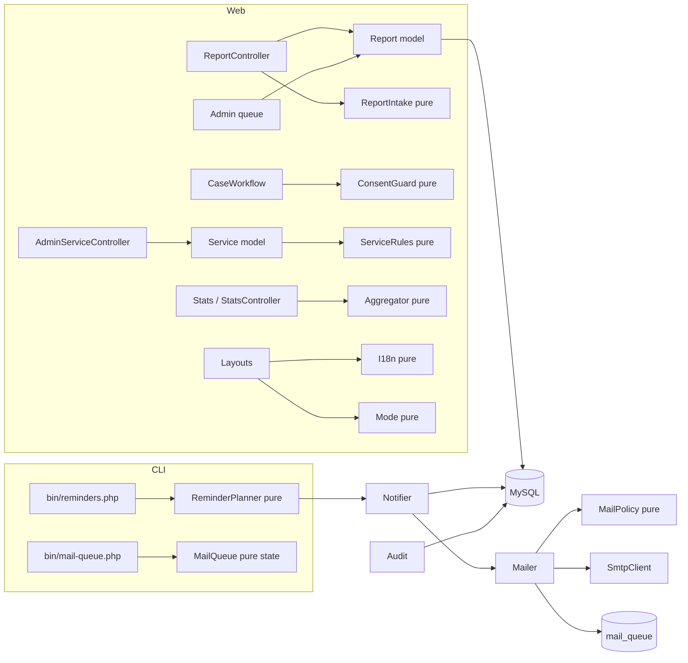

# Design Document: sdg5-improvements

## Overview

Dokumen ini menjabarkan desain teknis untuk 10 requirement di `requirements.md`. Haven adalah aplikasi PHP vanilla MVC + MySQL, jadi desain ini memakai pola yang sudah ada: model statis dengan `Database::*`, controller tipis, view PHP, `Notifier`, `Audit`, `Crypto`, `RateLimiter`, `Csrf`, dan `Validator`. Tidak ada framework atau dependensi baru kecuali satu hal: klien SMTP.

### Alur laporan (konteks untuk semua perubahan)

Alur status tetap `diterima → ditinjau → didampingi → dirujuk → selesai/ditutup` (`Report::STATUS`). Perubahan di dokumen ini menyisip di titik berikut:

| Tahap | Perubahan |
| --- | --- |
| Form lapor | Peran pelapor (korban/saksi), pertanyaan usia, kategori baru (Req 2, 4, 5) |
| `diterima` | SLA balasan tampil dan dipantau pengingat (Req 6) |
| `ditinjau` | Admin memilih pendamping. Kasus anak hanya ke pendamping terlatih (Req 4) |
| `dirujuk` | Laporan saksi butuh persetujuan korban. Nomor lembaga hanya tampil bila terverifikasi (Req 1, 5) |
| Semua tahap | Email SMTP dengan antrean ulang (Req 6). Statistik agregat (Req 7) |

### Keputusan desain utama

1. **Logika murni dipisah dari I/O.** Aturan yang bisa diuji (SLA, penurunan kasus anak, penggabungan sel kecil, kebijakan email, mode ringan) ditaruh di fungsi statis tanpa akses DB atau superglobal. Controller dan model hanya memanggilnya. Ini membuat property test mungkin tanpa DB.
2. **Satu sumber kebenaran kategori.** `Report::CATEGORIES` menjadi acuan. Enum `reports.category` di `schema.sql` harus sama persis. Diverifikasi oleh tes konsistensi.
3. **Migrasi lewat `schema.sql` saja** (Req 10.12). Proyek memakai `bin/db-reset.php` pada DB kosong. Untuk DB yang sudah berisi data (Req 2.4) disediakan blok `ALTER` idempoten di `database/migrations/` yang tidak mengubah baris lama.
4. **Pengingat dan antrean email dijalankan dari CLI** (`bin/reminders.php`, `bin/mail-queue.php`), tanpa daemon. Dijadwalkan oleh Windows Task Scheduler atau cron.
5. **SMTP tanpa Composer.** Proyek tidak punya `vendor/`. Dipakai klien SMTP kecil di `app/core/SmtpClient.php` (STARTTLS/SSL, AUTH LOGIN, timeout 30 detik) agar tidak menambah dependensi. Alternatif PHPMailer ditolak karena menambah Composer ke proyek yang tidak memakainya.

### Pembagian area kerja

| | Area A (Pelapor dan Kasus) | Area B (Konten, Layanan, Publik) |
| --- | --- | --- |
| Requirement | 2, 4, 5, 6 | 1, 3, 7, 8, 9 |
| File utama | `Report.php`, `ReportController`, `CaseWorkflow`, `Notifier`, `Mailer`, `bin/reminders.php`, view `report/*`, `admin/queue.php` | `Service.php`, `AdminServiceController`, `Stats.php`, `seed-content.sql`, `I18n`, `Mode`, layout, `tentang.php`, `README.md`, `app/config/team.php` |
| Tabel baru | `report_reminders`, `mail_queue`, `report_consents` | Tidak ada. Audit layanan memakai `audit_logs` yang sudah ada |
| Kolom baru | `reports.reporter_type`, `reports.is_child`, `reports.victim_age_answer`, `reports.victim_contact_enc`, `users.child_trained`, enum kategori | Tidak ada |

## Architecture



Lapisan:

- **Pure rules** (`app/core/rules/*.php`): tanpa DB, tanpa session, tanpa waktu global. Waktu dikirim sebagai parameter `DateTimeImmutable`.
- **Models**: query dan transaksi, memanggil pure rules.
- **Controllers**: CSRF, rate limit, otorisasi, `Audit::log`, render.

### Titik temu A dan B

| Berkas | Siapa mengubah | Aturan penggabungan |
| --- | --- | --- |
| `database/schema.sql` | A dan B | Satu blok per tabel. A hanya menyentuh `users`, `reports`, dan tabel baru A. B tidak mengubah skema (tidak ada kolom baru di Area B). Tabel baru A ditaruh di akhir berkas di bawah komentar `-- Area A`. |
| `database/seed.sql` | A dan B | A menambah pendamping `child_trained` dan laporan contoh kategori baru. B menambah layanan terverifikasi (SAPA 129, UPTD PPA anak, KPAI) dan nomor 112. Tiap sisi memakai blok `-- AREA A` / `-- AREA B` terpisah. |
| `Report::CATEGORIES` | A | B (Req 7) hanya membaca. B menggabungkan setelah A merge kategori. |
| `Service::` data panel anak | B menyediakan `Service::findChildServices()`, A memakainya | Disepakati kontrak: mengembalikan tiga entri bernama tetap (lihat Components). |
| `Stats::` SLA | B memakai `Sla::*` milik A | A merge `app/core/rules/Sla.php` lebih dulu. |

Urutan merge yang disarankan: (1) A: kategori + `Sla`, (2) B: `Service`, (3) A: sisanya, (4) B: `Stats` dan sisanya.

## Components and Interfaces

### Area B

#### `ServiceRules` (pure, Req 1)

```php
final class ServiceRules {
    /** Public shape of a service. phone/whatsapp null iff unverified. */
    public static function publicView(array $s): array;
    /** @return array<string,string> field => pesan Indonesia */
    public static function verificationErrors(array $in, DateTimeImmutable $today): array;
    /** Apakah status verifikasi harus direset. */
    public static function nextVerified(array $old, array $new): bool;
    public static function isStale(?string $verifiedAt, DateTimeImmutable $today): bool; // > 180 hari
    public static function formatDate(string $ymd): string; // DD-MM-YYYY
    /** @param list<array> $services @return array<string,int> uptd, polisi, rs, lbh */
    public static function unverifiedCounts(array $services): array;
}
```

`Service::publicArray` memanggil `ServiceRules::publicView`. `Service::save` memanggil `nextVerified` dan menulis satu entri `Audit::log('service.save', 'service', (string)$id, "verifikasi: lama→baru")` dalam request yang sama.

Perubahan perilaku dari kode sekarang:

- `publicArray` sudah menyembunyikan telepon di JSON. Tampilan HTML (`services/index.php`, `case/*`, `report/sent`) harus lewat `publicView` agar tidak ada jalur lain yang membocorkan nomor.
- `validationErrors` ditambah: `verified_at` tidak boleh setelah hari ini dan harus `YYYY-MM-DD` valid. Kontak dihitung setelah `trim`.
- `save` untuk layanan terverifikasi yang nomornya berubah mengatur `is_verified = 0`, `verified_at = NULL` dalam `UPDATE` yang sama.
- Label "Perlu dicek ulang" hanya di daftar Admin. Publik tetap menampilkan nomor.

`Service::findChildServices(): array` mengembalikan tepat tiga entri berkunci `uptd_ppa_anak`, `kpai`, `sapa_129`. Pencocokan lewat kolom `tags` (`panel-anak:uptd`, `panel-anak:kpai`, `panel-anak:sapa129`) di seed, bukan lewat nama, supaya perubahan nama tidak memutus panel.

#### Statistik (Req 7)

```php
final class Aggregator {   // pure
    /** @param list<array{category:string,province:string,created_at:string,status:string}> $rows */
    public static function breakdown(array $rows, string $dim): array;        // 1 dimensi
    public static function cross(array $rows, string $d1, string $d2): array; // 2 dimensi
    public static function merge(array $counts, int $min = 5): array;          // sel kecil ke "Lainnya"
    public static function medianHours(array $durationsMinutes): ?int;         // null = "belum ada data"
    public static function slaPercent(int $met, int $total): ?float;           // 1 desimal
    public static function parseRange(string $from, string $to): array|string; // [from,to] atau pesan error
    public static function csv(array $sections): string;
}
```

Aturan penggabungan (menggantikan `Stats::mergeSmall` yang menyembunyikan sisa kecil):

1. Sel dengan n < 5 digabung ke "Lainnya".
2. Jika "Lainnya" sendiri masih 1 sampai 4, ia digabung ke sel terkecil yang tersisa, atau seluruh dimensi ditandai "data belum cukup" bila tidak ada sel lain. Dengan begitu tidak ada baris bernilai 1 sampai 4 (Req 7.10) dan jumlah grup tetap sama dengan total (Req 7.11).
3. Jika total rentang 1 sampai 4, tidak ada baris dan tampil pesan data belum cukup (Req 7.13).

Penjumlahan ke sel terkecil yang tersisa menjaga total, tetapi sedikit mengaburkan label. Alternatif "sembunyikan sisa" (perilaku `mergeSmall` sekarang) dibatalkan karena melanggar Req 7.11.

CSV hanya berisi kolom `dimensi, label, jumlah`, bulan `YYYY-MM`, tanpa kode, user id, teks bebas. Endpoint `POST /admin/statistik/ekspor` memeriksa peran `admin` (403), CSRF, lalu `Audit::log('stats.export', ...)` berisi admin id, waktu, rentang.

Median waktu balasan memakai selisih menit dari `report_status_logs.to_status='diterima'` ke pesan pendamping pertama (`messages.sender_role='companion'`). Persentase SLA memakai `Sla::hoursFor`.

#### `I18n` dan `Mode` (Req 8)

```php
final class I18n {   // pure
    public static function t(string $key, string $lang, array $dict): string; // fallback ke 'id', lalu ke $key
}
final class Mode {   // pure
    public static function lite(?string $sessionChoice, ?string $saveDataHeader): bool;
}
final class Emergency {  // pure
    /** @return list<array{label:string,number:string}> selalu memuat 112 dan 129 */
    public static function options(array $verifiedServices): array;
}
```

- Kamus di `app/lang/id.php` dan `app/lang/en.php`. Bahasa dan mode ringan disimpan di `Session`, diganti lewat `POST /bahasa` dan `POST /mode` (CSRF, `RateLimiter`).
- `Mode::lite`: pilihan sesi menang atas `Save-Data: on`.
- `layouts/*` menulis `<html lang>` dari bahasa aktif, tautan "Lewati ke konten" sebagai elemen fokus pertama, dan `<main id="konten" tabindex="-1">`.
- Mode ringan menghilangkan `` sampul, `<canvas>`, dan skrip polling. Formulir lapor harus tetap berfungsi tanpa JavaScript, jadi pengiriman memakai `POST` biasa dan kesalahan dirender server-side dengan `aria-describedby`, serta fokus awal lewat atribut `autofocus` pada kolom tidak valid pertama.
- Anggaran 100 KB diukur di tes manual/skrip `bin/check-lite-size.php` yang menjumlahkan HTML + CSS + JS yang dimuat.
- Nomor darurat 112 dan 129 ditulis tetap di partial `partials/emergency.php`, ditambah entri dari layanan terverifikasi bila ada.

#### Konten edukasi (Req 3)

`database/seed-content.sql` menambah lima artikel atau lebih. Idempotensi lewat `INSERT ... ON DUPLICATE KEY UPDATE` pada `slug` unik, dan kategori lewat `INSERT IGNORE`. Seluruh berkas dibungkus `START TRANSACTION; ... COMMIT;` dan dijalankan oleh `SqlFile` dengan `rollBack` bila ada kesalahan (Req 3.8). Tes konten memeriksa panjang judul, ringkasan, jumlah kata (≥ 400), waktu baca, dan teks alt.

#### Data tim (Req 9)

`app/config/team.php` mengembalikan daftar `['name','nim','modules'=>[…]]`. `tentang.php` membaca berkas itu. `README.md` tabel tim dibuat dari berkas yang sama oleh `bin/sync-team.php` (cek mode `--check` untuk tes). Inisial avatar: `mb_strtoupper(mb_substr($name, 0, 1))`.

### Area A

#### `ReportIntake` (pure, Req 2, 4, 5)

```php
final class ReportIntake {
    public const AGE = ['ya', 'tidak', 'tidak-yakin'];
    public const REPORTER = ['korban', 'saksi'];
    /** @return array{is_child:bool, urgency:string} */
    public static function derive(array $in): array;
    public static function intakeErrors(array $in): array; // jenis, usia, peran
}
```

`derive`: `is_child = usia ∈ {ya, tidak-yakin} OR jenis = 'perkawinan-anak'`. `urgency = tinggi` bila `is_child` atau `jenis = 'perdagangan-orang'` atau `bahaya = ya`; selain itu aturan lama `initialUrgency`.

Catatan: Req 4.3 hanya menyebut jawaban usia. Req 2.9 menambah kategori `perkawinan-anak` sebagai pemicu `is_child`. Desain menggabungkan keduanya: jawaban "tidak" dengan kategori `perkawinan-anak` tetap `is_child = true`. Ini perlu dikonfirmasi saat review (lihat Error Handling, "Konflik aturan anak").

Kategori baru (slug): `kdrt`, `kekerasan-pacaran`, `psikis`, `ekonomi`, `perkawinan-anak`, `perdagangan-orang`. Slug memakai tanda hubung seperti slug lama (`belum-yakin`). Req 2.2 kini menyebut huruf kecil, angka, tanda hubung, dan garis bawah, sehingga pola `[a-z0-9_-]{1,40}` yang dipakai desain dan kode sudah sejalan dengan requirement serta membuat data lama tetap valid.

`Report::create` menerima `reporter_type`, `is_child`, `victim_age_answer`, `victim_contact` (terenkripsi ke `victim_contact_enc`, maks 255 karakter).

#### `ConsentGuard` (pure, Req 5)

```php
final class ConsentGuard {
    /** @return ?string pesan error bila perubahan status ditolak */
    public static function check(string $reporterType, bool $hasConsent, string $to): ?string;
}
```

Menolak `to = 'dirujuk'` bila `reporterType = 'saksi'` dan belum ada persetujuan. `CaseWorkflow::transition` memanggilnya sebelum menulis. Persetujuan disimpan di `report_consents(report_id, companion_id, created_at)` lewat `POST /pendamping/kasus/{kode}/persetujuan`.

#### Penugasan kasus anak (Req 4.9, 4.10)

```php
final class Assignment {  // pure
    /** @return array{list:list<array>, warning:bool, needsConfirm:bool} */
    public static function candidates(array $companions, array $report): array;
}
```

Kasus anak: pendamping `child_trained = 1` di wilayah laporan. Bila kosong: `warning = true`, `needsConfirm = true`, daftar semua pendamping dengan wilayah sama di depan. `CaseWorkflow` menolak penugasan tanpa `confirm=1` dalam kondisi itu.

#### `ChildReferral` (pure, Req 4.5, 4.6)

`ChildReferral::panel(array $threeServices): list<array{name,contact,verified}>` selalu tepat tiga entri. Entri tak terverifikasi: `contact = null`, label "Perlu verifikasi". Ditampilkan di `report/sent.php` dan halaman lacak bila `is_child`.

#### `Sla` dan `ReminderPlanner` (pure, Req 6)

```php
final class Sla {
    public static function hours(bool $inDanger, array $env): int;   // default 2 / 48
    public static function isOverdue(array $case, DateTimeImmutable $now, array $env): bool;
    public static function periodIndex(DateTimeImmutable $exceededAt, DateTimeImmutable $now, int $slaHours): int;
}
final class ReminderPlanner {
    /**
     * @param list<array> $cases kasus kandidat
     * @param list<string> $sent kunci "case:type:period" yang sudah dibuat
     * @return list<array{case_id:int,type:string,period:int,recipients:list<int>}>
     */
    public static function plan(array $cases, array $sent, DateTimeImmutable $now, array $env, array $adminIds): array;
}
```

- Tipe `danger_unanswered`: `in_danger = 1`, status `diterima`, lewat SLA 2 jam sejak dibuat. Penerima: semua admin aktif.
- Tipe `no_reply`: pesan survivor terakhir belum dibalas melewati SLA. Penerima: pendamping tertuju + admin, atau admin saja bila belum ada.
- Kunci unik `(report_id, type, period)` di tabel `report_reminders` dengan `UNIQUE KEY`. `INSERT IGNORE` membuat run berulang tidak menambah apa pun (idempotensi 6.6). Periode = `floor((now - exceededAt) / SLA)`.
- Penyintas anonim tanpa email hanya mendapat notifikasi dalam aplikasi, tidak pernah email (6.15).
- Skrip `bin/reminders.php` keluar 0 bila sukses. Bila koneksi DB gagal: tulis `Logger`, keluar 1, tidak membuat pengingat (6.16). Seluruh run berada dalam satu transaksi.
- Konfigurasi: `SLA_DANGER_HOURS`, `SLA_DEFAULT_HOURS` di `.env`. Nilai bukan bilangan bulat positif memakai default.
- Badge "Lewat SLA" di `admin/queue.php` memakai `Sla::isOverdue`.

#### `MailPolicy`, `MailQueue`, `SmtpClient` (Req 6.9 sampai 6.15)

```php
final class MailPolicy {  // pure
    public const ALWAYS = ['password_reset', 'invitation'];
    public static function mode(array $env): string;                  // 'smtp' | 'log'
    public static function mayDeliver(string $type, bool $allowEmail): bool;
    public static function containsForbidden(string $subject, string $body, array $secrets): bool;
}
final class MailQueue {   // pure state machine
    public const MAX_RETRY = 5; public const INTERVAL_MIN = 10;
    /** @return 'send'|'wait'|'drop' */
    public static function decide(int $failedRetries, DateTimeImmutable $lastAttempt, DateTimeImmutable $now): string;
}
```

`Mailer::send(string $to, string $subject, string $body, string $type = 'general')`:

1. `mayDeliver` salah: tidak dikirim, tidak diantre.
2. `mode = 'log'` (host atau port kosong): tulis ke `storage/mail.log` seperti sekarang.
3. Selain itu coba `SmtpClient` dengan timeout 30 detik. Gagal: masukkan ke `mail_queue`.
4. `bin/mail-queue.php` memproses antrean. Pada percobaan ulang kelima yang gagal: log tanpa isi email (waktu, penerima, tipe), notifikasi ke semua admin aktif, hapus dari antrean.

Template email tidak menerima kronologi, PIN, atau kode laporan sebagai parameter. `containsForbidden` dipakai sebagai pagar di `Mailer::send`.

## Data Models

### Perubahan `users`

| Kolom | Tipe | Catatan |
| --- | --- | --- |
| `child_trained` | `TINYINT(1) NOT NULL DEFAULT 0` | Pendamping terlatih kasus anak (Req 4.9) |

### Perubahan `reports`

| Kolom | Tipe | Catatan |
| --- | --- | --- |
| `category` | `ENUM(... 12 nilai ...)` | Sama dengan `array_keys(Report::CATEGORIES)` |
| `reporter_type` | `ENUM('korban','saksi') NOT NULL DEFAULT 'korban'` | Req 5.2 |
| `victim_age_answer` | `ENUM('ya','tidak','tidak-yakin') NULL` | NULL untuk laporan lama |
| `is_child` | `TINYINT(1) NOT NULL DEFAULT 0` | Req 4.3 |
| `victim_contact_enc` | `TEXT NULL` | AES-256-GCM lewat `Crypto::enc` (Req 5.9) |
| `KEY idx_reports_child` | `(is_child, status)` | Filter antrean |

Semua penambahan kolom memakai default sehingga baris lama tidak berubah (Req 2.4). Migrasi untuk DB berisi: `database/migrations/2026-sdg5.sql` dengan `ALTER TABLE ... ADD COLUMN IF NOT EXISTS` dan perluasan enum yang hanya menambah nilai di akhir.

### Tabel baru (Area A)

```sql
CREATE TABLE report_consents (
  id INT UNSIGNED AUTO_INCREMENT PRIMARY KEY,
  report_id INT UNSIGNED NOT NULL,
  companion_id INT UNSIGNED NOT NULL,
  created_at DATETIME NOT NULL,
  UNIQUE KEY uq_consent_report (report_id),
  CONSTRAINT fk_consent_report FOREIGN KEY (report_id) REFERENCES reports (id) ON DELETE CASCADE,
  CONSTRAINT fk_consent_user FOREIGN KEY (companion_id) REFERENCES users (id)
);

CREATE TABLE report_reminders (
  id INT UNSIGNED AUTO_INCREMENT PRIMARY KEY,
  report_id INT UNSIGNED NOT NULL,
  type ENUM('danger_unanswered','no_reply') NOT NULL,
  period INT UNSIGNED NOT NULL,
  created_at DATETIME NOT NULL,
  UNIQUE KEY uq_reminder (report_id, type, period),
  CONSTRAINT fk_reminder_report FOREIGN KEY (report_id) REFERENCES reports (id) ON DELETE CASCADE
);

CREATE TABLE mail_queue (
  id INT UNSIGNED AUTO_INCREMENT PRIMARY KEY,
  to_email_enc TEXT NOT NULL,
  type VARCHAR(40) NOT NULL,
  subject VARCHAR(190) NOT NULL,
  body_enc MEDIUMTEXT NOT NULL,
  failed_retries TINYINT UNSIGNED NOT NULL DEFAULT 0,
  last_attempt_at DATETIME NOT NULL,
  created_at DATETIME NOT NULL,
  KEY idx_mail_due (last_attempt_at)
);
```

Tabel baru tidak menyimpan IP atau user id untuk laporan anonim (Req 10.4). `report_consents.companion_id` adalah pendamping, bukan penyintas. Alamat dan isi email dienkripsi di antrean karena bisa memuat data pribadi.

### Seed (titik temu)

- Area A: pendamping contoh dengan `child_trained = 1`, laporan contoh kategori baru.
- Area B: layanan `SAPA 129`, `UPTD PPA anak`, `KPAI` dengan tag `panel-anak:*`, entri 112, artikel di `seed-content.sql`.

## Correctness Properties

*A property is a characteristic or behavior that should hold true across all valid executions of a system-essentially, a formal statement about what the system should do. Properties serve as the bridge between human-readable specifications and machine-verifiable correctness guarantees.*

Refleksi redundansi: 1.1 dan 1.11 digabung (Property 1). 2.9, 2.10, 4.3, 4.7 digabung ke satu fungsi turunan (Property 7). 4.2 dan 5.1 digabung (Property 8). 4.8 dan 2.8 digabung (Property 9). 7.1 dan 7.11 digabung (Property 21). 7.3, 7.4, 7.6, 7.10 digabung (Property 22). 6.3, 6.4, 6.5, 6.6, 6.15 digabung ke tiga properti perencana. 5.9 dan 10.10 digabung ke satu properti round-trip dengan properti kedua untuk deteksi perubahan (10.11). 8.12 dan 8.14 digabung (Property 27). Kriteria UI, kinerja, WCAG, dan integrasi tidak menjadi properti dan ditutup oleh tes contoh di Testing Strategy.

### Property 1: Tampilan publik layanan menyembunyikan nomor jika belum terverifikasi

*For any* layanan, `ServiceRules::publicView` mengembalikan `phone` dan `whatsapp` bernilai null jika dan hanya jika layanan itu tidak terverifikasi, dan memuat nilai aslinya jika terverifikasi.

**Validates: Requirements 1.1, 1.11**

### Property 2: Validasi verifikasi layanan

*For any* masukan layanan dengan `is_verified = 1`, hasil `verificationErrors` kosong jika dan hanya jika setidaknya satu dari telepon atau WhatsApp tidak kosong setelah `trim`, dan `verified_at` berformat `YYYY-MM-DD` valid yang tidak lebih dari tanggal hari ini.

**Validates: Requirements 1.3, 1.4, 1.5**

### Property 3: Mengubah kontak mereset verifikasi

*For any* pasangan data lama (terverifikasi) dan data baru, `nextVerified` bernilai false jika telepon atau WhatsApp berubah, dan mempertahankan status terverifikasi jika keduanya tidak berubah dan Admin tidak mencabutnya.

**Validates: Requirements 1.6**

### Property 4: Batas 180 hari untuk "Perlu dicek ulang"

*For any* tanggal verifikasi dan tanggal hari ini, `isStale` bernilai true jika dan hanya jika selisih hari lebih dari 180.

**Validates: Requirements 1.7**

### Property 5: Format tanggal DD-MM-YYYY

*For any* tanggal valid `YYYY-MM-DD`, `formatDate` menghasilkan `DD-MM-YYYY`, dan mengurai kembali hasilnya menghasilkan tanggal semula.

**Validates: Requirements 1.8**

### Property 6: Hitungan layanan belum terverifikasi per tipe

*For any* daftar layanan, `unverifiedCounts` mengembalikan tepat empat kunci (`uptd`, `polisi`, `rs`, `lbh`) dengan nilai sama dengan jumlah layanan tidak terverifikasi per tipe, dan 0 untuk tipe tanpa entri.

**Validates: Requirements 1.9**

### Property 7: Penurunan status anak dan urgensi

*For any* masukan laporan yang valid, `ReportIntake::derive` memberi `is_child = true` jika jawaban usia adalah `ya` atau `tidak-yakin` (atau kategori `perkawinan-anak`), `is_child = false` jika jawaban `tidak` dan kategori bukan `perkawinan-anak`, dan `urgency = tinggi` jika `is_child` atau kategori `perdagangan-orang`, terlepas dari jawaban lain.

**Validates: Requirements 2.9, 2.10, 4.3, 4.7**

### Property 8: Pilihan wajib ditolak bila tidak valid

*For any* string `s` yang bukan anggota himpunan sah, `intakeErrors` memuat kesalahan untuk kolom itu bila `s` dipakai sebagai kategori, jawaban usia, atau peran pelapor, dan tidak memuat kesalahan untuk nilai yang sah.

**Validates: Requirements 2.6, 4.2, 5.1**

### Property 9: Filter antrean

*For any* himpunan laporan dan filter kategori atau filter kasus anak, setiap laporan yang dikembalikan memenuhi filter, dan setiap laporan yang memenuhi filter ikut dikembalikan. Lencana "Anak" muncul tepat pada laporan dengan `is_child = true`.

**Validates: Requirements 2.8, 4.8**

### Property 10: Panel rujukan anak

*For any* tiga layanan dengan status verifikasi acak, `ChildReferral::panel` mengembalikan tepat tiga entri bernama, dan entri tidak terverifikasi memiliki kontak null dan label "Perlu verifikasi", sedangkan entri terverifikasi memuat kontaknya.

**Validates: Requirements 4.5, 4.6**

### Property 11: Kandidat penugasan kasus anak

*For any* daftar pendamping dan laporan anak, jika ada pendamping terlatih di wilayah laporan maka hanya merekalah yang ditawarkan tanpa peringatan. Jika tidak ada, `warning = true`, `needsConfirm = true`, dan semua pendamping ditawarkan dengan yang berwilayah sama lebih dulu.

**Validates: Requirements 4.9, 4.10**

### Property 12: Format kode laporan dan PIN

*For any* laporan baru (korban atau saksi), kode cocok dengan `HV-` diikuti enam karakter sesuai alfabet `ReportCode`, kode unik terhadap kode yang sudah ada, dan PIN terdiri dari tepat 6 digit.

**Validates: Requirements 5.3**

### Property 13: Persetujuan korban sebelum rujukan saksi

*For any* kombinasi jenis pelapor, status persetujuan, dan status tujuan, `ConsentGuard::check` menolak jika dan hanya jika jenis pelapor `saksi`, tujuan `dirujuk`, dan persetujuan belum tercatat.

**Validates: Requirements 5.8**

### Property 14: Enkripsi round-trip dan kontak korban tersimpan terenkripsi

*For any* string UTF-8 sepanjang 0 sampai 10.000 karakter, `Crypto::dec(Crypto::enc(s))` sama dengan `s`, dan untuk string tidak kosong `Crypto::enc(s)` tidak memuat `s` sebagai teks biasa.

**Validates: Requirements 5.9, 10.3, 10.10**

### Property 15: Perubahan ciphertext terdeteksi

*For any* ciphertext hasil `Crypto::enc` dan posisi byte mana pun yang diubah (termasuk tag autentikasi), `Crypto::dec` gagal dan tidak mengembalikan plaintext.

**Validates: Requirements 10.11**

### Property 16: Jam SLA dari konfigurasi

*For any* nilai konfigurasi (string acak, termasuk kosong, nol, negatif, desimal, dan bukan angka), `Sla::hours` mengembalikan nilai itu bila berupa bilangan bulat positif, dan 2 (bahaya) atau 48 (lainnya) bila tidak.

**Validates: Requirements 6.1**

### Property 17: Lencana "Lewat SLA"

*For any* kasus dan waktu sekarang, `Sla::isOverdue` bernilai true jika dan hanya jika selisih waktu sejak acuan (pembuatan laporan atau pesan penyintas terakhir yang belum dibalas) lebih besar dari jam SLA kasus itu.

**Validates: Requirements 6.8**

### Property 18: Penerima pengingat

*For any* himpunan kasus, `ReminderPlanner::plan` membuat satu pengingat tipe bahaya untuk setiap kasus `in_danger` berstatus `diterima` yang melewati SLA dengan penerima semua admin aktif. Untuk tipe tanpa balasan, penerima adalah pendamping tertuju ditambah admin, atau admin saja bila belum ada pendamping. Penyintas anonim tanpa email tidak pernah menjadi penerima email.

**Validates: Requirements 6.3, 6.4, 6.15**

### Property 19: Satu pengingat per periode dan idempotensi

*For any* himpunan kasus dan serangkaian waktu run, jumlah pengingat per `(kasus, tipe, periode)` paling banyak satu, dan menjalankan `plan` lagi dengan himpunan `sent` hasil run sebelumnya pada waktu yang sama menghasilkan daftar kosong.

**Validates: Requirements 6.5, 6.6**

### Property 20: Kebijakan pengiriman email

*For any* tipe email dan nilai `allow_email`, `mayDeliver` bernilai true jika `allow_email = 1`, atau jika tipe adalah `password_reset` atau `invitation`. Untuk konfigurasi `.env` acak, `mode` bernilai `log` jika dan hanya jika host atau port kosong.

**Validates: Requirements 6.10, 6.14**

### Property 21: Mesin status antrean email

*For any* jumlah percobaan gagal 0 sampai 5 dan selisih waktu, `MailQueue::decide` mengembalikan `wait` bila belum 10 menit sejak percobaan terakhir, `send` bila sudah 10 menit dan percobaan gagal kurang dari 5, dan `drop` setelah percobaan ulang kelima gagal.

**Validates: Requirements 6.11, 6.12**

### Property 22: Teks sensitif tidak masuk email, notifikasi, atau log

*For any* kronologi, PIN, dan kode laporan acak, subjek dan isi email yang dibangun dari template, judul notifikasi, dan entri log baru tidak memuat kronologi, PIN, ataupun (untuk email) kode laporan sebagai substring.

**Validates: Requirements 6.13, 10.2**

### Property 23: Penjumlahan agregat statistik

*For any* himpunan laporan dan rentang tanggal valid dengan total 0 atau minimal 5, jumlah semua grup pada setiap dimensi (kategori, provinsi, bulan, status) sama dengan total laporan dalam rentang, dan hanya laporan dalam rentang yang dihitung.

**Validates: Requirements 7.1, 7.11**

### Property 24: Tidak ada sel kecil pada keluaran agregat

*For any* hitungan satu atau dua dimensi, hasil `merge` tidak memuat baris bernilai 1 sampai 4, penggabungan yang sama dipakai di layar dan CSV, dan bila total 1 sampai 4 tidak ada baris sama sekali.

**Validates: Requirements 7.3, 7.4, 7.6, 7.10, 7.13**

### Property 25: Median dan persentase SLA

*For any* daftar durasi, `medianHours` sama dengan median bulat jam dari daftar itu dan null bila kosong (ditampilkan "belum ada data"). *For any* `met ≤ total`, `slaPercent` sama dengan `met/total*100` dibulatkan satu desimal.

**Validates: Requirements 7.2, 7.14**

### Property 26: Isi CSV hanya agregat

*For any* himpunan laporan, CSV hasil `csv` tidak memuat kode laporan, user id, teks bebas, maupun stempel waktu lebih halus dari bulan.

**Validates: Requirements 7.5**

### Property 27: Validasi rentang tanggal

*For any* pasangan string tanggal, `parseRange` mengembalikan rentang jika keduanya valid dan awal tidak setelah akhir, dan mengembalikan pesan kesalahan selain itu.

**Validates: Requirements 7.12**

### Property 28: Terjemahan dengan cadangan bahasa Indonesia

*For any* kunci dan bahasa, `I18n::t` mengembalikan terjemahan bila ada, dan string Bahasa Indonesia bila terjemahan tidak ada.

**Validates: Requirements 8.7**

### Property 29: Resolusi mode ringan

*For any* pilihan sesi (`null`, `on`, `off`) dan header `Save-Data`, `Mode::lite` mengikuti pilihan sesi bila ada, dan mengikuti header `Save-Data: on` hanya bila sesi belum memilih.

**Validates: Requirements 8.10, 8.13**

### Property 30: Opsi panggilan darurat selalu ada

*For any* daftar layanan terverifikasi (termasuk kosong), `Emergency::options` selalu memuat nomor 112 dan 129.

**Validates: Requirements 8.12, 8.14**

### Property 31: Inisial avatar

*For any* nama lengkap tidak kosong (termasuk karakter multibyte), inisial avatar adalah karakter pertama nama dalam huruf besar.

**Validates: Requirements 9.4**

## Error Handling

| Situasi | Penanganan |
| --- | --- |
| Validasi form lapor gagal (kategori, usia, peran) | `back_with` dengan pesan per kolom dan nilai lama (kecuali PIN). Tidak ada laporan tersimpan |
| CSRF salah atau hilang | `HttpException(419)`, tanpa perubahan data (Req 10.9) |
| Batas laju terlampaui | `HttpException(429)` dengan pesan menunggu (Req 10.8). Laporan saksi memakai kunci `report:ip:` dan ambang yang sama dengan korban |
| Simpan layanan terverifikasi tanpa kontak atau tanggal salah | Tolak, data lama tidak berubah, pesan Indonesia |
| Ubah status saksi ke `dirujuk` tanpa persetujuan | `ConsentGuard` menolak, status tetap, pesan "persetujuan korban diperlukan" |
| Penugasan kasus anak tanpa pendamping terlatih | Peringatan, perlu `confirm=1` |
| Admin mengakses tampilan atau ekspor berisi kronologi | `HttpException(403)` (Req 10.1) |
| Pengguna non-admin meminta ekspor agregat | 403, tanpa berkas dan tanpa `Audit` ekspor |
| SMTP gagal atau timeout 30 detik | Masuk `mail_queue`, ulang paling banyak 5 kali per 10 menit, lalu log tanpa isi dan notifikasi admin |
| DB tidak tersedia saat `bin/reminders.php` | Log gagal, keluar kode non-nol, tanpa pengingat |
| Dekripsi gagal (tag diubah) | `Crypto::dec` mengembalikan null. Pemanggil menampilkan pesan, tidak pernah plaintext sebagian |
| Seed konten gagal | Transaksi di-rollback, artikel lama utuh, galat dilaporkan ke pelaksana |
| Rentang statistik tidak valid | Tanpa statistik dan tanpa ekspor, pesan rentang tidak valid |
| Kunci terjemahan hilang | Cadangan Bahasa Indonesia |

Konflik aturan anak: Req 2.9 menjadikan `perkawinan-anak` sebagai Child_Case, sedangkan Req 4.3 menyatakan jawaban "tidak" tidak menandai Child_Case. Desain mengutamakan perlindungan: kategori `perkawinan-anak` tetap `is_child = true`. Bila ini tidak diinginkan, ubah satu baris di `ReportIntake::derive` dan Property 7.

## Testing Strategy

### Pendekatan ganda

Fitur ini cocok untuk property-based testing pada lapisan logika murni (`app/core/rules/*`, `Crypto`, `Aggregator`). Lapisan I/O (query DB, SMTP, tampilan, WCAG, kinerja) diuji dengan tes contoh dan integrasi.

- **Tes properti**: Property 1 sampai 31, pada fungsi murni atau fungsi dengan DB uji kecil.
- **Tes unit/contoh**: label "Perlu verifikasi", enam kategori baru, konsistensi `CATEGORIES`/`CATEGORY_DESC`/enum, konten artikel (panjang, jumlah kata, alt), `team.php` sama dengan README, tautan lewati konten, `aria-describedby`, notifikasi saksi, audit log, 403 dan CSRF per endpoint.
- **Tes integrasi/smoke**: `bin/db-reset.php` pada DB kosong (Req 10.12), migrasi pada DB berisi (Req 2.4), seed konten dua kali dan rollback saat gagal, SMTP palsu dengan timeout 30 detik, `bin/reminders.php` keluar 0 dan non-nol, formulir lapor tanpa JavaScript, anggaran 100 KB mode ringan, pencarian artikel di bawah 2 detik.
- **Di luar otomatisasi**: WCAG AA penuh dan zoom 200% (Req 8.1, 8.4) diperiksa dengan audit alat (mis. axe) ditambah daftar periksa manual.

### Pustaka dan konfigurasi

- Proyek belum punya kerangka tes. Dipakai **PHPUnit** untuk runner dan **Eris** (`giorgiosironi/eris`) untuk property-based testing PHP. Properti tidak ditulis dari nol.
- Tiap properti dijalankan minimal **100 iterasi** (`->limitTo(100)`).
- Setiap properti diimplementasikan oleh **satu** tes properti.
- Tiap tes diberi komentar tag: `Feature: sdg5-improvements, Property {nomor}: {teks properti}`.
- Tes memakai folder `tests/`. Properti 9 dan 12 memakai DB MySQL uji (`haven_test`) yang dibuat oleh `bin/db-reset.php`. Properti lain tidak butuh DB.
- Waktu selalu diberikan sebagai parameter `DateTimeImmutable`, tidak memakai `time()` di fungsi murni.

### Pembagian tes antar area

| Area | Properti | Berkas tes |
| --- | --- | --- |
| A | 7 sampai 22 | `tests/Report*`, `tests/Sla*`, `tests/Mail*`, `tests/Crypto*` |
| B | 1 sampai 6, 23 sampai 31 | `tests/Service*`, `tests/Stats*`, `tests/I18n*`, `tests/Mode*`, `tests/Team*` |

Property 10 (panel anak) dimiliki A tetapi bergantung pada kontrak `Service::findChildServices()` dari B.
